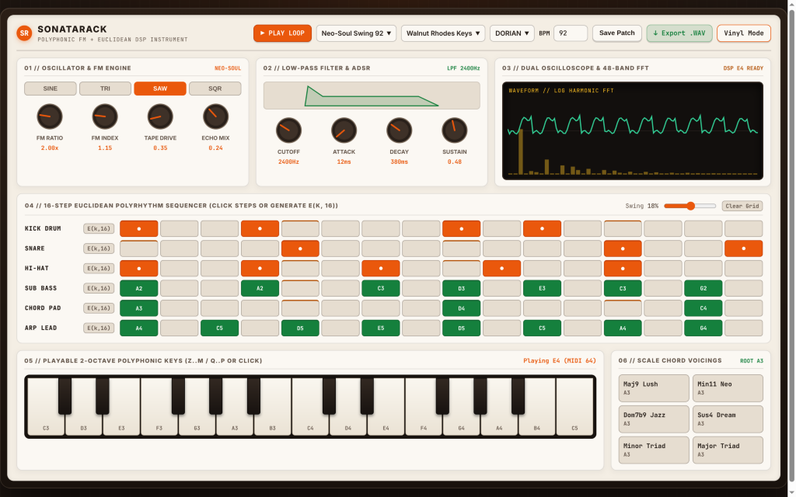
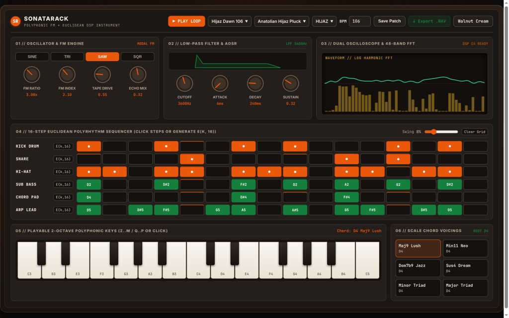

# SonataRack

> **Polyphonic FM + Additive/Subtractive Hardware Synth & Euclidean Polyrhythm Studio** built with FastAPI, NumPy/SciPy DSP, Web Audio API, and an interactive walnut-and-cream modular rack UI (with one-click Late-Night Jazz Vinyl Dark mode).

## Studio Visuals

### 1. Walnut & Satin Cream Hardware Theme (Daylight Studio)


### 2. Late-Night Jazz Vinyl Dark Theme (`Anatolian Hijaz Pluck` + `Maj9 Lush`)


## Architecture & Core Capabilities

1. **Pure Python / NumPy / SciPy Offline DSP Engine (`src/sonatarack/dsp.py`)**
   - Multi-waveform core oscillator (`sine`, `tri`, `saw`, `sqr`) coupled with **Phase-Modulation / FM Synthesis** (`fm_ratio`, `fm_index`).
   - Vectorized **ADSR amplitude envelope**, low-pass harmonic attenuation (`cutoff`), asymmetric **tape saturation** (`tape_drive`), and feedback **echo/delay stage** (`echo_mix`).
   - Real-time 48-bin logarithmic **FFT spectral analyzer** (`compute_fft_spectrum`) and multi-bar 44.1 kHz 16-bit PCM `.wav` sequencer mixdown (`render_pattern_wav` with drum synthesis + pitched bass/pad/arp tracks + swing timing).

2. **Music Theory & Euclidean Rhythm Engine (`src/sonatarack/theory.py`)**
   - Exact **Bjorklund Euclidean algorithm** (`euclidean_rhythm(pulses, steps, rotation)`) for maximally even rhythmic pulse spacing and rotation.
   - Modal scales (`dorian`, `hijaz`, `phrygian`, `aeolian`, `ionian`, `lydian`, `mixolydian`, `pentatonic_minor`, `blues`, etc.) and extended jazz/neo-soul chord builders (`maj9`, `min11`, `dom7b9`, `sus4`, `minor`, `major`).

3. **Hardware-Inspired Web Audio Rack (`static/`)**
   - **Module 01 — Oscillator & FM Engine**: Waveform selector + SVG rotary knobs (`-135 deg` to `+135 deg` drag/wheel interaction).
   - **Module 02 — Low-Pass Filter & ADSR**: Interactive SVG envelope plot updating live alongside cutoff, attack, decay, and sustain knobs.
   - **Module 03 — Dual Oscilloscope & 48-Band FFT**: OLED hardware scope rendering time-domain waveform and harmonic spectrum.
   - **Module 04 — 16-Step Euclidean Polyrhythm Sequencer**: 6 lanes (`KICK DRUM`, `SNARE`, `HI-HAT`, `SUB BASS`, `CHORD PAD`, `ARP LEAD`) with instant `E(k, 16)` generators, swing slider, and transport clock.
   - **Module 05 & 06 — 2-Octave Playable Keyboard & Scale Chord Voicings**: Computer-keyboard playable (`Z..M`, `Q..P`) + polyphonic Web Audio engine.

## API Endpoints (`src/sonatarack/app.py`)

| Method | Endpoint | Purpose |
| :--- | :--- | :--- |
| `GET` | `/api/studio/state` | Returns stored patches, patterns, supported scales, and chord types |
| `POST` | `/api/patches` | Persists a custom `SynthPatch` into SQLite storage |
| `POST` | `/api/patterns` | Persists a multi-track 16-step sequence with BPM & swing |
| `GET` | `/api/theory/euclidean` | Generates a rotated Bjorklund `E(k, n)` pulse pattern |
| `GET` | `/api/theory/scale` | Returns modal scale notes and chord voicing MIDI mappings |
| `POST` | `/api/dsp/preview` | Renders a note in NumPy and returns waveform + 48-band FFT bins |
| `POST` | `/api/render/wav` | Exports a downloadable 44.1 kHz `.wav` loop mixdown |

## Quick Start & Verification

```bash
pip install -e .
sonatarack serve --host 127.0.0.1 --port 11450 --open
```

Run the full test suite (`node --test` + `pytest`):

```bash
make test
```
